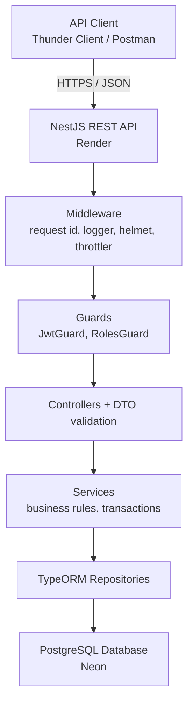
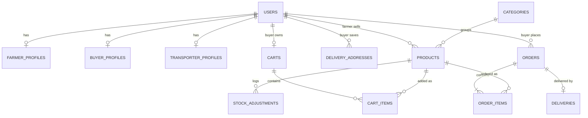

# FarmerBD Backend

FarmerBD is a Smart Agri Supply Chain Platform. Farmers list their crops, buyers order them directly, and an admin manages the platform. This repository contains the **backend REST API only**.

Built for the course **CSC4161 - Advance Programming in Web Technology** and demonstrated through an API client (Thunder Client / Postman).

| Resource | Link |
|---|---|
| Live backend (API base URL) | https://farmerbd-backend.onrender.com/api |
| GitHub repository | https://github.com/shafikulnayem10/FarmerBD-Backend |

> **Note on cold starts:** The backend runs on Render's free tier and spins down after 15 minutes of inactivity. The first request after a pause can take around a minute. Open `/api` once before testing or a demo to wake the service up.

---

## Table of Contents

1. [Features](#features)
2. [Tech Stack](#tech-stack)
3. [Architecture Overview](#architecture-overview)
4. [Folder Structure](#folder-structure)
5. [Data Model (ER Diagram)](#data-model-er-diagram)
6. [Local Setup](#local-setup)
7. [Environment Variables](#environment-variables)
8. [API Documentation](#api-documentation)
9. [Testing with Thunder Client](#testing-with-thunder-client)
10. [Core Logic and Design Decisions](#core-logic-and-design-decisions)
11. [Assumptions and Limitations](#assumptions-and-limitations)
12. [Problems Faced and Solutions](#problems-faced-and-solutions)
13. [Deployment](#deployment)

---

## Features

### Authentication and Roles

- Register and login with JWT. Passwords are hashed with bcrypt.
- Role-based route protection using `JwtGuard`, `RolesGuard` and the `@Roles` decorator.
- Suspended accounts receive `403`.
- Roles: `FARMER`, `BUYER`, `ADMIN`, `TRANSPORTER`.

| Role | What it can do |
|---|---|
| FARMER | Manage own profile and products, handle incoming orders |
| BUYER | Manage profile and delivery addresses, browse products, use the cart, place and track orders |
| ADMIN | Manage categories, farmer verification, product moderation, users, orders, transporters and delivery pricing. The first Admin is seeded from environment variables |
| TRANSPORTER | Can register and log in and is managed by the Admin. A Transporter self-service API is not implemented yet |

### Farmer

- Farm profile (farm name, division, district, upazila, farm size, primary crops, bio).
- Product CRUD with soft delete, stock updates and a `DRAFT` / `ACTIVE` / `ARCHIVED` status.
- Publish rule: a product can be made `ACTIVE` only when the farmer has a farm name and district and the stock is above 0.
- Incoming order list with filters, then accept, reject and move the order through the status flow.

### Buyer

- Buyer profile and multiple delivery addresses (one default).
- Public product catalog with search, filters, sorting and a price comparison against similar listings.
- Cart grouped by farmer, with the delivery fee calculated by the server.
- Checkout creates **one order per farmer** in a single database transaction.
- Order history, cancel (only while `PENDING`) and delivery confirmation.

### Order Lifecycle

```text
PENDING -> ACCEPTED -> PREPARING -> READY_FOR_PICKUP -> DELIVERED -> COMPLETED
   |
   +-> REJECTED   (by the farmer)
   +-> CANCELLED  (by the buyer)
```

- The Farmer moves an order up to `DELIVERED`. The Buyer confirms delivery to reach `COMPLETED`.
- Payment is Cash on Delivery.
- Reject and cancel restore the reserved stock inside a transaction.

### Platform

- Pagination on every list endpoint.
- Request id middleware, request logger middleware and a response time interceptor (`X-Response-Time` header).
- Rate limiting and security headers.
- Environment validation with Joi at start-up.

---

## Tech Stack

| Layer | Technology |
|---|---|
| Backend | NestJS, TypeScript (ESM), REST API |
| Database | PostgreSQL, TypeORM |
| Authentication | JWT (`@nestjs/jwt`, `passport-jwt`), bcrypt |
| Validation | class-validator, class-transformer, Joi (environment) |
| Security | `@nestjs/throttler`, `helmet` |
| API Testing | Thunder Client (VS Code extension), manual testing |
| Backend Hosting | Render (free web service) |
| Database Hosting | Neon (free PostgreSQL) |

---

## Architecture Overview



### Architecture Responsibilities

- **Middleware and interceptor:** assign a request id, log requests and add the `X-Response-Time` header.
- **Guards:** `JwtGuard` checks the token. `RolesGuard` checks `@Roles(...)`.
- **Controllers:** handle routes and parameters. DTO classes validate the input.
- **Services:** contain the business rules (publish rules, stock reservation, order status flow, delivery fee) and run database transactions.
- **Repositories:** database access through TypeORM.
- **Global ValidationPipe:** `whitelist`, `forbidNonWhitelisted` and `transform` are enabled, so unknown fields are rejected.

---

## Folder Structure

```text
FarmerBD-Backend/
│
├── .env.example
├── package.json
└── src/
    ├── main.ts           app bootstrap (prefix, helmet, CORS, pipes, `/` redirect)
    ├── app.module.ts
    │
    ├── admin/            admin controllers and services
    ├── auth/             register, login, JWT strategy, guards, roles decorator
    ├── buyer-orders/     checkout, buyer orders, cancel, confirm delivery
    ├── buyers/           buyer profile and delivery addresses
    ├── cart/             cart and cart items
    ├── categories/       categories and default seed
    ├── common/           enums, constants, DTOs, middleware, interceptor, transformers
    ├── config/           environment validation (Joi)
    ├── database/         TypeORM connection
    ├── deliveries/       delivery records (managed by Admin)
    ├── farmer-orders/    farmer order handling
    ├── farmers/          farmer profile
    ├── notifications/    notification entity and service
    ├── orders/           order and order item entities
    ├── pricing/          fuel price and delivery settings
    ├── products/         products, catalog, stock rules
    ├── root/             root welcome endpoint (GET /api)
    ├── transporters/     transporter profiles (managed by Admin)
    └── users/            user entity and service
```

---

## Data Model (ER Diagram)

The main relationships of the application are shown below. Only the key columns are listed.



Other tables: `fuel_prices`, `delivery_settings`, `district_locations` (delivery pricing) and `notifications`.

### Relationship Types

- **One to many:** farmer to products, category to products, buyer to delivery addresses, order to order items.
- **Many to many through link tables:** carts and products (`cart_items`), orders and products (`order_items`).
- **One to one:** user to farmer profile, user to buyer profile, buyer to cart.

### Database Rules

- Products use **soft delete**, so old orders can still show the product.
- Money and quantity columns use a numeric transformer so TypeORM returns numbers instead of strings.
- Stock is changed only inside transactions that lock the product rows.

---

## Local Setup

### Prerequisites

- Node.js (current LTS, 22 recommended) and npm
- PostgreSQL
- Git
- pgAdmin 4 (recommended)

### 1. Clone the Repository

```bash
git clone https://github.com/shafikulnayem10/FarmerBD-Backend.git
cd FarmerBD-Backend
```

### 2. Create the Database

Create an empty PostgreSQL database named:

```text
FarmerBD_DB
```

### 3. Environment File

**Windows (PowerShell):**

```powershell
copy .env.example .env
```

**Linux / macOS:**

```bash
cp .env.example .env
```

Fill in your PostgreSQL password and a `JWT_SECRET` of at least 32 characters.

### 4. Install and Run

```bash
npm install
npm run start:dev
```

The API runs at:

```text
http://localhost:3000/api
```

### 5. Schema Management

There are **no migrations**. TypeORM `synchronize` creates and updates the tables only when `NODE_ENV=development`.

On start-up the app seeds:

- 9 default categories
- the delivery settings and district coordinates
- the Admin account (only when no Admin exists and the `ADMIN_*` variables are set)

### Useful Scripts

```bash
npm run start:dev      # development with auto reload
npm run build          # compile to dist/
npm run start:prod     # run the compiled build (node dist/main)
```

---

## Environment Variables

Copy `.env.example` to `.env`. Never commit the `.env` file.

| Variable | Example | Description |
|---|---|---|
| `NODE_ENV` | `development` | Tables are created automatically only when this is `development` |
| `PORT` | `3000` | Server port (assigned automatically on Render) |
| `FRONTEND_URL` | `http://localhost:5173` | Allowed origin for CORS. Must be a valid URL |
| `DATABASE_HOST` | `localhost` | PostgreSQL host |
| `DATABASE_PORT` | `5432` | PostgreSQL port |
| `DATABASE_USERNAME` | `postgres` | PostgreSQL username |
| `DATABASE_PASSWORD` | your password | PostgreSQL password |
| `DATABASE_NAME` | `FarmerBD_DB` | PostgreSQL database name |
| `JWT_SECRET` | 32+ characters | Secret used to sign tokens |
| `JWT_EXPIRES_IN` | `3600` | Token lifetime in seconds |
| `ADMIN_EMAIL` | `admin@example.com` | Optional. Used once to create the first Admin |
| `ADMIN_PHONE` | `01700000000` | Optional. Needed together with the other ADMIN variables |
| `ADMIN_PASSWORD` | your password | Optional |
| `ADMIN_NAME` | `System Admin` | Optional |

> **Security:** `.env` is excluded through `.gitignore`. Only `.env.example` with placeholder values is committed.

---

## API Documentation

**Base URL**

Production:

```text
https://farmerbd-backend.onrender.com/api
```

Local:

```text
http://localhost:3000/api
```

All request and response bodies use JSON. Protected routes need:

```text
Authorization: Bearer <accessToken>
```

### Conventions

- List responses: `{ "data": [...], "meta": { "page", "limit", "total", "totalPages" } }`. Defaults are `page=1`, `limit=10` (maximum 50).
- Unknown request fields are rejected with `400`.
- Errors use the default NestJS shape.
- Rate limits: 100 requests per minute globally, 5 per minute for login, 10 per minute for register.

### Error Response Format

```json
{
  "statusCode": 409,
  "message": "Not enough stock for Tomato",
  "error": "Conflict"
}
```

For validation errors, `message` is an array describing each problem.

### Status Codes

| Status | Meaning |
|---|---|
| 400 | Validation error |
| 401 | Missing or invalid token |
| 403 | Wrong role or suspended account |
| 404 | Not found, or not owned by the logged-in user |
| 409 | Conflict: duplicate data, not enough stock, wrong order status |
| 429 | Rate limit exceeded |

### Endpoint Summary

#### Auth

| Method | Endpoint | Access |
|---|---|---|
| POST | `/auth/register` | Public. Body: `fullName`, `email`, `phone`, `password`, `role` (`FARMER`, `BUYER` or `TRANSPORTER`) |
| POST | `/auth/login` | Public. Body: `email`, `password` |
| GET | `/auth/me` | Any logged-in user |

#### Public

| Method | Endpoint | Note |
|---|---|---|
| GET | `/` | Redirects to `/api` |
| GET | `/api` | Welcome message and API status (see below) |
| GET | `/categories` | List active categories |
| GET | `/products` | Query: `search`, `categoryId`, `minPrice`, `maxPrice`, `district`, `inStock`, `sort` (`newest`, `price_asc`, `price_desc`), `page`, `limit` |
| GET | `/products/:id` | Product detail with farmer card and price comparison |
| GET | `/fuel-prices/current` | Current diesel price set by the Admin |

#### Farmer

| Method | Endpoint | Note |
|---|---|---|
| GET | `/farmers/me` | Own profile and verification status |
| PATCH | `/farmers/me` | Body: `farmName`, `division`, `district`, `upazila`, `addressLine`, `farmSizeAcres`, `primaryCrops`, `bio` |
| POST | `/products` | Create a product (starts as `DRAFT`) |
| GET | `/farmers/me/products` | Own products. Query: `status`, `search`, `page`, `limit` |
| GET | `/farmers/me/products/:id` | One own product |
| PATCH | `/products/:id` | Update details and price |
| PATCH | `/products/:id/stock` | Body: `availableQuantity` |
| PATCH | `/products/:id/status` | Body: `status` (`DRAFT`, `ACTIVE`, `ARCHIVED`) |
| DELETE | `/products/:id` | Soft delete |
| GET | `/farmers/me/orders` | Incoming orders. Query: `status`, `from`, `to`, `page`, `limit` |
| PATCH | `/orders/:id/accept` | Accept a pending order |
| PATCH | `/orders/:id/reject` | Body: `reason`. Restores stock |
| PATCH | `/orders/:id/status` | Body: `status` (`PREPARING`, `READY_FOR_PICKUP`, `DELIVERED`), in this order only |

#### Buyer

| Method | Endpoint | Note |
|---|---|---|
| GET | `/buyers/me` | Own profile |
| PATCH | `/buyers/me` | Body: `buyerType`, `businessName` |
| GET | `/buyers/me/addresses` | List delivery addresses |
| POST | `/buyers/me/addresses` | Body: `label`, `recipientName`, `phone`, `division`, `district`, `upazila`, `addressLine`, `isDefault` |
| PATCH | `/buyers/me/addresses/:id` | Update an address or make it the default |
| DELETE | `/buyers/me/addresses/:id` | Delete an address |
| GET | `/cart` | Cart grouped by farmer with subtotals, delivery fees and total |
| POST | `/cart/items` | Body: `productId`, `quantity` |
| PATCH | `/cart/items/:itemId` | Body: `quantity` |
| DELETE | `/cart/items/:itemId` | Remove an item |
| DELETE | `/cart` | Clear the cart |
| POST | `/orders/checkout` | Body: `addressId`, `note`. One order per farmer, in one transaction |
| GET | `/buyers/me/orders` | Own orders. Query: `status`, `from`, `to`, `page`, `limit` |
| PATCH | `/orders/:id/cancel` | Body: `reason`. Only `PENDING` orders. Restores stock |
| PATCH | `/orders/:id/confirm-delivery` | `DELIVERED` to `COMPLETED` |

#### Shared (Buyer or Farmer who owns the order)

| Method | Endpoint | Note |
|---|---|---|
| GET | `/orders/:id` | Order detail with items |

#### Admin

| Method | Endpoint |
|---|---|
| GET | `/admin/dashboard` |
| GET | `/admin/users` |
| PATCH | `/admin/users/:id/status` |
| GET, POST | `/admin/categories` |
| PATCH, DELETE | `/admin/categories/:id` |
| GET | `/admin/farmers` |
| PATCH | `/admin/farmers/:id/verification` |
| PATCH | `/admin/products/:id/status` |
| GET | `/admin/products/:id/stock-logs` |
| GET | `/admin/orders` |
| GET | `/admin/orders/:id` |
| PATCH | `/admin/orders/:id/assign-transporter` |
| PATCH | `/admin/orders/:id/cancel` |
| GET, POST | `/admin/transporters` |
| PATCH | `/admin/transporters/:id/verification` |
| GET, POST | `/admin/fuel-prices` |
| GET, PATCH | `/admin/delivery-settings` |

### Root Endpoint

`GET /api` is public and returns a welcome message. It only shows that the API process is running. It does not check the database. `GET /` redirects to `/api`.

```json
{
  "success": true,
  "message": "Welcome to FarmerBD API!",
  "description": "A platform connecting farmers directly with buyers across Bangladesh.",
  "version": "1.0.0",
  "status": "running",
  "timestamp": "2026-11-27T00:00:00.000Z"
}
```

### Example 1: Register

```http
POST /api/auth/register
```

```json
{
  "fullName": "Rahim Uddin",
  "email": "rahim.farmer@example.com",
  "phone": "01711111111",
  "password": "Password123",
  "role": "FARMER"
}
```

The response contains an `accessToken`. Use it in the `Authorization` header of the next requests.

### Example 2: Update Stock

```http
PATCH /api/products/:id/stock
```

```json
{
  "availableQuantity": 120
}
```

Stock cannot be changed through the generic `PATCH /products/:id`. It has its own route so every change can be logged as a stock adjustment.

### Example 3: Checkout

```http
POST /api/orders/checkout
```

```json
{
  "addressId": "b3c1f0a2-0000-0000-0000-000000000000",
  "note": "Please deliver in the morning"
}
```

One order is created for each farmer in the cart. If any product has too little stock, nothing is saved and the API returns `409`.

### Example 4: Farmer Moves an Order Forward

```http
PATCH /api/orders/:id/status
```

```json
{
  "status": "PREPARING"
}
```

The next status must follow the flow exactly. Skipping a step returns `409`.

---

## Testing with Thunder Client

The API was tested manually with the [Thunder Client](https://www.thunderclient.com/) VS Code extension.

### Setup

1. Create an environment with a variable `baseUrl`.
2. Set its value to `http://localhost:3000/api` for local testing, or `https://farmerbd-backend.onrender.com/api` for the deployed API.
3. Register and log in as a Farmer and as a Buyer. Save each `accessToken` in its own variable (for example `farmerToken` and `buyerToken`).
4. Use `Bearer {{farmerToken}}` or `Bearer {{buyerToken}}` in the Auth tab.

### Test Coverage

| Area | Test Cases |
|---|---|
| Authentication | Register as Farmer and Buyer, duplicate email, wrong password, login, `GET /auth/me`, missing token returns 401 |
| Role protection | Buyer token on a Farmer route returns 403, Farmer token on a Buyer route returns 403 |
| Farmer profile | Update farm profile, publishing a product without farm name or district is rejected |
| Products | Create, list own products, get one, update, change stock, change status, soft delete |
| Public catalog | Search, category and price filters, sorting, pagination, product detail |
| Address and cart | Create address, default address, add to cart, update quantity, remove item, clear cart |
| Checkout | Order per farmer, delivery fee (60 or 120), not enough stock returns 409 and saves nothing |
| Order flow | Accept, reject with reason, `PREPARING`, `READY_FOR_PICKUP`, `DELIVERED`, buyer confirm, wrong order returns 409 |
| Stock restore | Stock goes back after reject and after buyer cancel |
| Ownership | A farmer or buyer cannot open another user's order (404) |
| Validation | Unknown field, missing field, invalid UUID, quantity below the minimum |

There is no automated test suite. Verification was done manually with Thunder Client.

---

## Core Logic and Design Decisions

### 1. Stock Reservation with Row Locks

**Where:** `ProductsService.reserveStock` and `restoreStock`

When two buyers order the last items at the same time, a plain read then update can sell the same stock twice. To prevent this:

1. Checkout runs inside one `dataSource.transaction`.
2. The product ids are **sorted** before locking, so two transactions always lock rows in the same order and cannot deadlock.
3. Each product is read with a `pessimistic_write` lock.
4. The product must exist, be `ACTIVE`, meet the minimum order quantity and have enough stock. Otherwise the whole checkout fails with `409` and nothing is saved.
5. Stock is decreased. When it reaches 0 the product becomes `OUT_OF_STOCK`.

`restoreStock` adds the quantity back (also for soft-deleted products) and changes `OUT_OF_STOCK` back to `ACTIVE`.

### 2. Order Row Locking

Farmer accept, reject and status updates, and buyer cancel and confirm, all lock the order row first. This stops a farmer accepting an order at the same moment the buyer cancels it.

### 3. Order Status State Machine

The farmer status route uses a `NEXT_STATUS` map. A status change is allowed only if it is the next step of the current status. Any other change returns `409`.

### 4. Delivery Fee

**Where:** `cart-math.ts`

The fee is fixed for each farmer order, not per item:

- **BDT 60** if the farmer district equals the delivery district
- **BDT 120** otherwise

The server calculates it. The client never sends a price.

### 5. One Order per Farmer

A cart can contain products from many farmers. Checkout splits it into one order per farmer so each farmer sees and handles only their own order.

### 6. Other Design Decisions

- **Soft delete for products:** old orders keep a valid reference.
- **Ownership returns 404:** a user who asks for someone else's record gets `404`, so ids are not leaked.
- **Validation at the API boundary:** DTOs with `whitelist` and `forbidNonWhitelisted`.
- **Separate stock route and stock log:** every stock change can be traced.
- **Cash on Delivery only:** online payment was out of scope.

---

## Assumptions and Limitations

### Assumptions

- Payment is Cash on Delivery.
- The Farmer marks an order `DELIVERED` and the Buyer confirms it to reach `COMPLETED`.
- Registration is allowed for `FARMER`, `BUYER` and `TRANSPORTER`. Admin accounts are created only from environment variables.
- Delivery fee is a fixed amount per farmer order (60 or 120 BDT).

### Limitations

- The Transporter has no self-service API yet. Transporters are managed by the Admin.
- Backend only. There is no frontend.
- No migrations. The schema is created by `synchronize` when `NODE_ENV=development`.
- No Swagger documentation. The API is documented in this README.
- No automated test suite.
- No online payment, email or SMS notification.
- Free hosting introduces cold-start delays.

---

## Problems Faced and Solutions

### 1. ESM Project and Import Paths

**Problem:** The project uses ES modules, so relative imports need a `.js` extension even in TypeScript files. Entities that reference each other also caused circular-import errors.

**Solution:** Added `.js` to every relative import and used `import type { Relation }` for bidirectional entity relations.

### 2. Overselling Stock

**Problem:** Two buyers ordering the last items together could both succeed.

**Solution:** Moved checkout into one transaction with `pessimistic_write` locks. Product ids are sorted before locking to avoid deadlocks.

### 3. Partial Orders When One Item Fails

**Problem:** A cart with products from several farmers could save some orders and fail on another.

**Solution:** All orders of one checkout are created in the same transaction. If anything fails, everything rolls back and the API returns `409`.

### 4. Cancel and Accept at the Same Time

**Problem:** The buyer could cancel while the farmer accepts, leaving the stock and status in a wrong state.

**Solution:** Every order action locks the order row first and then checks the current status.

### 5. Numeric Values Returned as Strings

**Problem:** PostgreSQL `numeric` columns came back as strings in JSON.

**Solution:** Added a numeric transformer on money and quantity columns.

### 6. Deploying Without Migrations

**Problem:** The project has no migrations, but the tables must exist on the hosted database.

**Solution:** Set `NODE_ENV=development` on Render so TypeORM `synchronize` creates the tables at start-up.

### 7. Free Hosting Cold Start

**Problem:** Render's free web service sleeps after 15 minutes, so the first request takes about a minute.

**Solution:** It cannot be removed on the free tier. It is documented at the top of this README, and `/api` can be opened once to wake the service.

---

## Deployment

| Component | Provider | Configuration |
|---|---|---|
| Database | Neon (PostgreSQL, free tier) | Connection details set through environment variables |
| Backend | Render (free web service) | Node 22, build and start commands below |

**Build Command:**

```bash
npm install && npm run build
```

**Start Command:**

```bash
npm run start:prod
```

**Environment Variables on Render:**

```env
NODE_ENV=development
NODE_VERSION=22
PORT=3000
FRONTEND_URL=<your frontend or any valid URL>
DATABASE_HOST=<neon host>
DATABASE_PORT=5432
DATABASE_USERNAME=<neon user>
DATABASE_PASSWORD=<neon password>
DATABASE_NAME=<neon database>
JWT_SECRET=<32+ characters>
JWT_EXPIRES_IN=3600
ADMIN_EMAIL=<admin email>
ADMIN_PHONE=<admin phone>
ADMIN_PASSWORD=<admin password>
ADMIN_NAME=System Admin
```

`NODE_ENV=development` is used because the project has no migrations and relies on `synchronize` to create the tables.

---

**Built with NestJS, TypeORM, PostgreSQL and TypeScript.**
